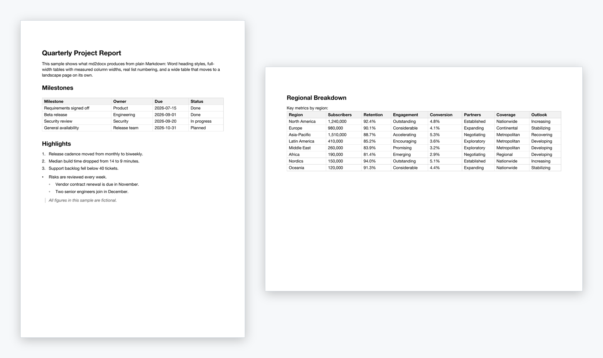
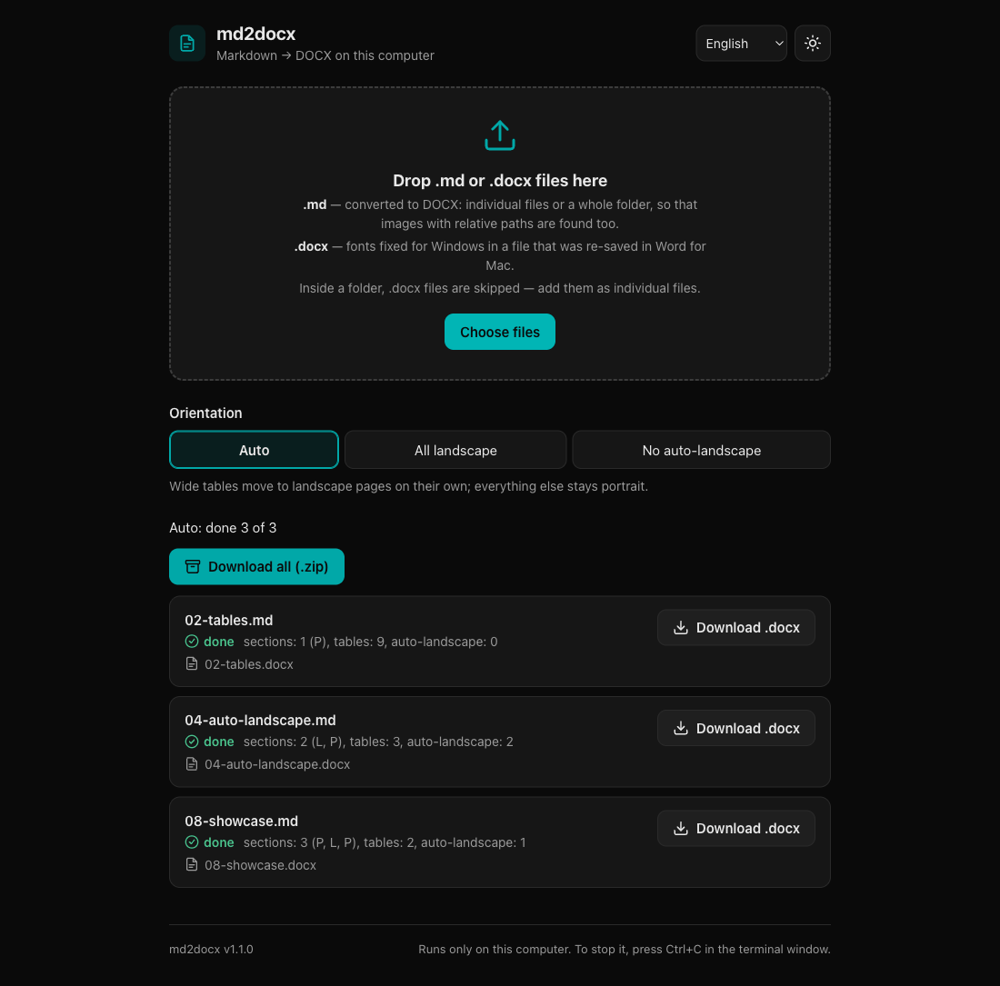

# md2docx — конвертер Markdown в Word (DOCX) с аккуратными таблицами и альбомными страницами

[](https://github.com/denbellousov/markdown-to-docx/releases)

[](LICENSE)

[English](README.md) | **Русский**

**md2docx — локальный конвертер Markdown в DOCX для документов с таблицами.** Он превращает
`.md` в документ Word со встроенными стилями заголовков Word, таблицами на всю ширину текста,
у которых ширины колонок посчитаны по реальной ширине текста, и смешанными книжными
и альбомными страницами: таблица, которая не влезает в книжную страницу, сама уходит на
альбомную вместе со своим заголовком. md2docx — один файл на Python, ему не нужны pandoc,
LibreOffice и сеть; к нему есть необязательный интерфейс в браузере, который работает
на `127.0.0.1`, в том числе готовым приложением для macOS и Windows.



## Возможности

- **Заголовки** — встроенные стили Word «Заголовок 1–6»: работают панель навигации
  и автоматическое оглавление.
- **Таблицы** — на всю ширину текста. Ширины колонок считаются по реальной ширине текста
  (Pillow и файлы шрифтов): короткие колонки остаются узкими, длинному тексту достаётся
  место. Шапка серая и полужирная, границы тонкие серые, строки не рвутся между страницами,
  выравнивание колонок из `:---:` и `---:` сохраняется.
- **Автоальбомные страницы.** Таблица, которая не помещается на книжной странице без
  разрыва слов, уходит на альбомную вместе с заголовком, подписью и коротким вступлением;
  сразу после неё документ возвращается к книжной ориентации.
- **Явная ориентация и разрывы страниц:** `<!-- landscape -->`, `<!-- portrait -->`,
  `<!-- pagebreak -->`, `\newpage`, `\pagebreak`. `\newpage` между строками таблицы режет
  её по этой строке.
- **Читается на Windows.** В таблице шрифтов записано, что Helvetica Neue заменять на Arial,
  а Menlo — на Consolas; `--fix-fonts` возвращает эти подсказки после Word для Mac.
- **Бережная запись.** Запись атомарная; документ, который правили после конвертации или
  который открыт в Word, md2docx без `--force` не перезаписывает.
- **Остальной CommonMark:** полужирный, курсив, зачёркнутый, код в строке, блоки кода
  (в ограде и с отступом), вложенные цитаты, вложенные списки на настоящей нумерации Word,
  гиперссылки, локальные картинки, горизонтальные линии, жёсткий перенос и `<br>`. YAML
  front matter и HTML-комментарии пропускаются; прочие HTML-теги удаляются, текст между ними
  остаётся, у HTML-блока — с предупреждением.
- **Приложение и интерфейс в браузере:** перетащить `.md`-файлы или папку, выбрать
  ориентацию, скачать `.docx` по одному или архивом `.zip`. Приложению для macOS и Windows
  Python не нужен.
- **Десять языков:** английский, китайский, хинди, испанский, французский, арабский,
  португальский, русский, немецкий и японский — по языку системы или браузера.

## Скачать приложение

Python не нужен: скачайте приложение для своей системы из
[последнего релиза](https://github.com/denbellousov/markdown-to-docx/releases/latest).

| Система | Файл |
|---|---|
| macOS, Apple silicon (M1 и новее) | [md2docx-macos-arm64.zip](https://github.com/denbellousov/markdown-to-docx/releases/latest/download/md2docx-macos-arm64.zip) |
| macOS, Intel | [md2docx-macos-intel.zip](https://github.com/denbellousov/markdown-to-docx/releases/latest/download/md2docx-macos-intel.zip) |
| Windows, 64 бита | [md2docx-windows-x64.exe](https://github.com/denbellousov/markdown-to-docx/releases/latest/download/md2docx-windows-x64.exe) |

Приложение открывает [интерфейс в браузере](#интерфейс-в-браузере) и показывает маленькое
окно с его адресом. Выход из приложения или закрытие этого окна останавливает md2docx
и удаляет его временные файлы; повторный запуск, пока приложение работает, снова открывает
страницу.

Приложения не подписаны, поэтому перед первым запуском система один раз переспросит:

- **macOS:** распакуйте архив, перенесите md2docx в «Программы» и откройте. Когда macOS
  скажет, что не может проверить приложение, откройте «Системные настройки» › «Конфиденциальность
  и безопасность», нажмите «Все равно открыть» рядом с сообщением про md2docx и подтвердите.
- **Windows:** если SmartScreen пишет «Система Windows защитила ваш компьютер», нажмите
  «Подробнее», затем «Выполнить в любом случае».

## Быстрый старт

```sh
git clone https://github.com/denbellousov/markdown-to-docx.git
cd markdown-to-docx
pip install -r requirements.txt
python3 md2docx.py samples/08-showcase.md -o showcase.docx
```

Нужны Python 3.10 или новее, `python-docx` и `markdown-it-py` (`lxml` ставится вместе
с `python-docx`). `Pillow` — необязательно, но желательно: без него ширины колонок
не измеряются, а оцениваются.

md2docx разрабатывается и проверяется на macOS с Python 3.13 (Word для Mac 16.114,
LibreOffice 25.8.3.2).
Ширины колонок измеряются по Helvetica Neue и Arial из шрифтов macOS или по Arial
из `C:\Windows\Fonts`; без этих шрифтов — оцениваются. Если скрыть шрифты Mac (только Arial
и совсем без шрифтов), все образцы дают ту же ориентацию страниц и проходят сверщик; на самих
Windows и Linux результат конвертера не проверялся. Сообщения — на языке системы, см.
[«Языки»](#языки).

## Запуск

```sh
python3 md2docx.py отчёт.md                     # → отчёт.docx рядом с исходником
python3 md2docx.py отчёт.md -o ~/Desktop/итог.docx
python3 md2docx.py a.md b.md c.md               # несколько файлов, каждый рядом со своим
python3 md2docx.py таблицы.md --landscape       # весь документ альбомный (маркеры переключают)
python3 md2docx.py отчёт.md --no-auto-landscape # широкие таблицы не уводить в альбомную
python3 md2docx.py отчёт.md --force             # перезаписать результат, даже если его правили
python3 md2docx.py --fix-fonts отчёт.docx        # вернуть подсказки шрифтов после Word для Mac
python3 md2docx.py --version
```

| Флаг | Что делает |
|---|---|
| `-o OUT.docx` | куда записать результат; только при одном входном файле |
| `--landscape` | документ начинается альбомным; маркеры по-прежнему переключают ориентацию |
| `--no-auto-landscape` | не уводить широкие таблицы на альбомные страницы |
| `--force` | перезаписать результат, даже если его правили после конвертации, он создан не md2docx или открыт в Word; с `--fix-fonts` — исправить файл, открытый в Word |
| `--fix-fonts FILE.docx …` | вернуть подсказки шрифтов для Windows в готовые `.docx` |
| `--version` | показать версию |

На каждый файл — строка итога, например
`Готово: отчёт.docx — разделов 3 (К, А, К), таблиц 5, из них авто-альбомных 2`
(К — книжный раздел, А — альбомный). Предупреждения (пропущенная картинка, ссылка
с неразрешённой схемой, HTML-блок, таблица не влезает в свою страницу без разрыва слов) идут
в stderr с префиксом `Внимание:`. Сообщения — на языке интерфейса (см. [«Языки»](#языки)),
примеры здесь — по-русски. Коды выхода: 0 — успех, 1 — файл не прочитан или
не записан (в том числе `-o` указывает на сам исходник — он не трогается; результат уже
есть и его нельзя перезаписать — см. [«Перезапись результата»](#перезапись-результата)),
2 — ошибка в аргументах (в том числе пустой `-o`). Ошибка в одном файле пакета
не останавливает остальные.

Вход — UTF-8 (с BOM или без) или UTF-16 с BOM. Другая кодировка — ошибка «файл не
в кодировке UTF-8»; нулевые байты без BOM — «похоже на UTF-16 без BOM или двоичный
файл — сохраните в UTF-8».

### Из Python

```python
from md2docx import convert, fix_fonts

stats = convert("отчёт.md", "отчёт.docx", landscape=False, auto_landscape=True, force=False)
restored = fix_fonts("отчёт.docx", force=False)
```

`stats` — словарь: `output` (путь результата), `sections` (ориентации разделов буквами,
`К` — книжный, `А` — альбомный, например `['К', 'А', 'К']`; эти буквы от языка интерфейса
не зависят), `tables`, `auto_landscape_tables` и `warnings` (список строк предупреждений
на языке интерфейса, без префикса `Внимание:`). Отказ перезаписать —
исключение `FileExistsError` с тем же текстом, что в CLI; `force=True` — как `--force`. Файл
не прочитан или не записан — `OSError` (например, `FileNotFoundError`), неподходящая
кодировка — `UnicodeDecodeError`.

`fix_fonts()` — то же, что `--fix-fonts`
(см. [«Шрифты на Windows и --fix-fonts»](#шрифты-на-windows-и---fix-fonts)): словарь
«шрифт → восстановленные поля», пустой — подсказки уже на месте (файл тогда
не перезаписывается, и замок Word не мешает).
Подсказки нужно вернуть, а файл открыт в Word — `FileExistsError`; не docx — `ValueError`;
файл не прочитан или не записан — `OSError`.

## Ориентация и разрывы страниц

Маркеры пишутся отдельной строкой между блоками; регистр и пробелы вокруг слова
не важны (`<!-- LANDSCAPE -->` — маркер, `<!-- land scape -->` — нет):

| Маркер | Что делает |
|---|---|
| `<!-- landscape -->` | дальше — альбомные страницы, с новой страницы |
| `<!-- portrait -->` | дальше — книжные страницы, с новой страницы |
| `<!-- pagebreak -->`, `\newpage`, `\pagebreak` | разрыв страницы |

- Маркер той же ориентации, что уже действует, ничего не делает — пустых страниц не будет.
- Маркер в самом начале файла задаёт ориентацию первой страницы, без разрыва.
- Несколько маркеров подряд: ориентация — по последнему маркеру ориентации, разрыв —
  если среди них есть хоть один разрыв. Новый раздел и так начинается с новой страницы,
  второго разрыва не будет. Маркеры в конце файла игнорируются. Блок без видимого
  содержимого (пустая цитата, комментарий, `<br>`, `&nbsp;`, пустой `#`) маркеры
  не разделяет и отдельной страницы не получает.
- `\newpage` или `\pagebreak` сразу под последней строкой таблицы (без пустой строки) —
  разрыв страницы после таблицы, а не её строка. `\\newpage` с экранированной косой
  чертой и `&#92;newpage` — обычный текст.
- `\newpage` или `\pagebreak` между строками таблицы режет её по целой строке:
  продолжение — с новой страницы, без шапки, с теми же колонками; в альбомную страницу
  таблица уходит целиком. Несколько разрывов — несколько частей, разрывы подряд — один.
  Разрыв сразу под строкой `|---|` — таблица целиком с новой страницы. Строка без `|`
  под разрывом — уже текст после таблицы. Комментарий `<!-- pagebreak -->` между строками
  таблицы её не режет, а заканчивает (так по GFM): строки под ним станут абзацем
  текста с `|`. Для разреза — `\newpage`.
- Внутри блока кода маркер — обычный текст; внутри списка или цитаты — игнорируется
  с предупреждением.

### Автоальбомная ориентация

Таблица, которая на книжной странице (17 см ширины текста) не помещается без разрыва слов,
сама уходит на альбомную страницу, а после неё документ возвращается к книжной. Переносом,
а не разрывом считается место после тире и после дефиса — кроме дефиса между нецифрой
и цифрой (`Ф-123456`, `АБ-2026` целиком, как переносит LibreOffice). Даты, коды и телефоны
(`2026-10-22`, `АБ-2026-001`) в таблице, которая влезает в книжную, остаются целыми,
но альбомную ориентацию сами по себе не вызывают.

Вместе с таблицей переезжает то, что к ней относится, — чтобы заголовок не остался
внизу книжной страницы:

- абзац-подпись, оканчивающийся двоеточием, прямо перед таблицей;
- заголовок над таблицей и все заголовки прямо над ним; между заголовком и таблицей
  допускается короткое вступление — до двух абзацев не длиннее 600 символов без картинок
  и одна горизонтальная линия;
- через такое же короткое вступление — заголовок старшего уровня (глава вместе
  с разделом, который начинается широкой таблицей).

Подтягивание останавливают разрыв страницы, начало размеченного участка, список,
цитата, код, другая таблица, HTML-блок с текстом, длинный абзац или абзац с картинкой,
заголовок того же или младшего уровня, третий абзац, вторая линия. Блоки без видимого содержимого
не мешают. Две широкие таблицы, между которыми не больше двух видимых блоков, нет
других таблиц и разрыва страницы, попадают на одну альбомную вставку. Выключается флагом
`--no-auto-landscape`. Участки, явно размеченные как альбомные, не трогаются.

## Оформление

- A4, поля 2 см со всех сторон в обеих ориентациях, без колонтитулов;
- текст — Helvetica Neue 11 pt, интервал после абзаца 8 pt, выравнивание влево;
- заголовки — встроенные стили Word «Заголовок 1–6» (работают панель навигации
  и оглавление): полужирные, 18/16/14/12/11/11 pt, H6 курсивом;
- таблицы — на всю ширину текста, тонкие серые границы, серая полужирная шапка
  в начале таблицы (на следующих страницах она не повторяется); если все ячейки шапки
  пусты, строки шапки нет. Строки не рвутся между страницами (кроме строки выше страницы);
  таблица не начинается внизу страницы шапкой с одной строкой и не кончается одной строкой
  на новой странице, если эти строки вместе помещаются: начало — в ¾ страницы, конец —
  в страницу (иначе заголовок над таблицей остался бы внизу страницы один); таблица
  в конце документа не даёт пустой последней страницы.
  Ширины колонок считаются по реальной ширине текста: если каждая ячейка помещается
  в одну строку, колонка получает свою самую широкую ячейку и долю свободного места
  пропорционально ей; иначе колонка не уже своего самого длинного слова, а остальное место
  делится по объёму текста колонок. Между заголовком и таблицей прямо под ним — отбивка 6 pt;
- списки — настоящая нумерация Word, каждый список нумеруется сам по себе и сохраняет свой
  начальный номер; отступы растут до восьмого уровня вложенности, глубже остаются на восьмом;
- цитаты — серый курсив с линией слева; код — Menlo 10 pt на серой плашке с отступом
  текста от её края, соседние блоки кода — отдельными плашками;
- ссылки — гиперссылки только для `http:`, `https:`, `mailto:` и `tel:`. Ссылка с другой
  схемой (`file:`, `data:`, `smb:`, `javascript:` …) остаётся текстом, с предупреждением;
  относительный путь и `#якорь` — текстом без предупреждения (переходов внутри
  документа нет);
- сноски (`[^1]` в тексте и строка `[^1]: …`) остаются обычным текстом на своих местах:
  настоящих сносок Word нет, но и текст не теряется;
- картинки — локальные файлы вставляются в документ: не шире текста (или ячейки)
  и не выше 0,8 высоты текстовой области страницы, пропорции сохраняются. Удалённая (URL),
  отсутствующая или нечитаемая картинка (например, SVG) и файл больше 50 МБ не вставляются —
  вместо них заглушка `[изображение: …]` (на языке интерфейса) с предупреждением;
  картинка вне каталога документа (путь ведёт выше по дереву или абсолютный вне каталога
  документа) вставляется, но с предупреждением;
- символы, которых нет в Helvetica Neue, но есть в Arial (например, `→`), набираются
  Arial — иначе Word для Mac рисует их Times New Roman. Для этого нужны Pillow и шрифты
  macOS; без них такие символы остаются в Helvetica Neue. Код не трогается.

### Строки таблицы у нижнего поля в LibreOffice

Если видимая на странице часть таблицы кончается ровно у нижнего поля, LibreOffice может
не вывести следующие строки таблицы: в файле они есть, а в PDF из LibreOffice их нет. Это
дефект LibreOffice. Замер — LibreOffice 25.8.3.2, таблица из 7 строк, верхнее поле
сдвигалось с шагом 0,05 pt, 71 вариант: в 10 вариантах подряд (окно 0,5 pt) первая
страница кончалась строкой 2 у самого поля, и строк 3–7 в PDF не было. Снятие повтора
шапки этого не исправляет: на результате 0.2.0, где шапка повторялась, — те же 10 потерь
из 71 при тех же сдвигах.

Word так не делает: в Word для Mac 16.114 из 70 вариантов 12 кончались у самого поля,
потерь строк 0 — в том числе с метриками Arial, как у Word на Windows без Helvetica Neue
(сам Word для Windows не проверялся).

Обход — `\newpage` в таблице на границе строк, выше пропавших, или перед таблицей (перед
её заголовком, если он есть): всё, что ниже разрыва, начинается с новой страницы,
и LibreOffice это выводит, даже если часть таблицы над разрывом по-прежнему кончается
у самого поля (так бывает при разрыве после строки 2). На тех же 71 сдвигах разрыв после
строки 1, после строки 2 или перед заголовком таблицы — потерь 0.

## Шрифты на Windows и `--fix-fonts`

На Windows шрифта Helvetica Neue обычно нет. Чтобы документ выглядел так же, в таблицу
шрифтов docx (`fontTable.xml`) записано, чем его заменить:

- Helvetica Neue → `altName` Arial, класс `swiss` (гротеск), `panose1`, переменная ширина;
- Menlo (код) → `altName` Consolas, класс `modern`, моноширинный.

По стандарту ISO/IEC 29500 (§17.8.3) эти поля и служат для подбора замены, когда шрифта
в системе нет; поведение Word с `altName` описано в
[MS-OI29500 2.1.262](https://learn.microsoft.com/en-us/openspecs/office_standards/ms-oi29500/f7c44a60-3d38-4925-8934-57d77c277e84).
Без этой записи Word подставил бы шрифт с засечками.

Вёрстка от подмены не зависит: у части глифов Arial шире Helvetica Neue (курсивная «т»,
скобки, кавычки), поэтому ширины колонок считаются по бо́льшему из двух замеров и ещё
с запасом 3 %. Проверено рендером с принудительной заменой Helvetica Neue → Arial:
ориентация страниц та же, слова в ячейках не рвутся. Страниц может стать меньше: строка
Arial примерно на 4 % ниже. Если на компьютере получателя Helvetica Neue установлена,
будет она.

**После правки в Word для Mac — `--fix-fonts`.** Word для Mac при любом сохранении
удаляет `altName` у системных шрифтов (MS-OI29500 2.1.262(c)) и вдобавок меняет класс
Helvetica Neue с `swiss` (гротеск) на `auto`; у Menlo пропадает `altName` Consolas, класс
`modern` остаётся (проверено в Word для Mac 16.114). Без этих подсказок Word на Windows
может подставить шрифт с засечками. Вернуть их в готовый файл — `--fix-fonts` (строка
в «Запуске»; из Python — `fix_fonts()`):

- что делает — меняет только таблицу шрифтов: записи Helvetica Neue и Menlo снова
  получают поля, которые пишет md2docx; если Helvetica Neue или Menlo в тексте есть,
  а записи об этом шрифте нет, она добавляется. Текст и правки документа не трогаются,
  остальные части файла — те же байты;
- когда запускать — после последнего сохранения в Word для Mac, перед отправкой файла.
  Если сохранить его в Word для Mac ещё раз, подсказки снова пропадут;
- файл, открытый в Word (рядом замок `~$…`), в котором подсказки нужно вернуть, без
  `--force` не меняется — отказ с кодом 1: закройте документ и запустите снова;
- итог — `Готово: отчёт.docx — восстановлены подсказки шрифтов: Helvetica Neue (altName,
  family), Menlo (altName)`; если подсказки на месте — `Без изменений: …`, и файл
  не переписывается. Не docx, битый архив, нет таблицы шрифтов — ошибка этого файла
  (код 1), остальные файлы исправляются; с `-o`, `--landscape`, `--no-auto-landscape`
  режим не сочетается (код 2).

Ограничение, которое внутри файла не исправить:

- Word запоминает замену шрифта на сессию (MS-OI29500 2.1.261(a)): если до нашего файла
  в той же сессии открыли документ с Helvetica Neue без `altName` (например, сохранённый
  в Word для Mac), наш файл получит ту же замену. Помогает закрыть Word целиком и открыть
  файл md2docx первым. Надёжнее — постоянная замена у получателя: File › Options ›
  Advanced › Show document content › Font Substitution, Helvetica Neue → Arial (путь для
  английского интерфейса).

Ещё для Word на Windows: документ помечен как документ Word 2013+ (`compatibilityMode` 15),
иначе Word открывает его в режиме совместимости и сдвигает таблицы в левое поле.

## Перезапись результата

Результат помечен как файл md2docx (`dc:identifier` в свойствах документа; Word эту
метку не показывает). Существующий файл перезаписывается молча, только если это
нетронутый результат md2docx: метка на месте и файл не сохраняли после конвертации
(ревизия 1, поле «кем изменён» пустое). Иначе — отказ с кодом 1: «… не перезаписываю;
чтобы перезаписать, добавьте --force». У результатов версий 0.1.0 и 0.1.1 метки нет —
их тоже перезаписывает только `--force`.

Результат, открытый в Word, не заменяется даже нетронутым. Word кладёт рядом с открытым
файлом замок `~$…`: имя без расширения до 6 символов — целиком (`отчёт.docx` →
`~$отчёт.docx`), из 7 символов — без первого, из 8 и больше — без двух первых
(`отчёт-2026.docx` → `~$чёт-2026.docx`). Если такой замок есть — отказ с кодом 1:
«отчёт.docx: файл открыт в Word (рядом ~$отчёт.docx) — закройте его или запустите
с --force». `--force` перезаписывает и в этом случае. Word закрыт, а замок остался —
удалите `~$…` рядом с файлом или запустите с `--force`. Разные файлы могут дать замок
с одним именем: открытый `cdefgh.docx` даёт отказ и для `abcdefgh.docx` (замок обоих —
`~$cdefgh.docx`), его снимает `--force`.

Запись атомарная: сначала временный файл в том же каталоге, затем замена. Если запись
сорвалась, прежний результат остаётся целым. Результат только для чтения не заменяется
и с `--force` — ошибка «нет доступа». Если результат — символьная ссылка, она остаётся
ссылкой: заменяется файл, на который она указывает. Права прежнего результата
сохраняются, жёсткие ссылки — нет: после замены это новый файл. Нужно право записи
в каталог результата, без него — «нет доступа: <каталог>». Два входа одного запуска с общим
результатом (`отчёт.md` и `отчёт.markdown` в одном каталоге) — ошибка для позднего,
результат раннего остаётся.

## Языки

Командная строка, страница в браузере и приложение говорят по-английски, по-китайски
(упрощённое письмо), на хинди, по-испански, по-французски, по-арабски, по-португальски
(Бразилия), по-русски, по-немецки и по-японски. Язык выбирается сам: `MD2DOCX_LANG`, если
задан, иначе `LANGUAGE`, `LC_ALL`, `LC_MESSAGES` или `LANG`, иначе язык операционной
системы; любой другой язык — английский. Страница следует языкам браузера, в её шапке есть
переключатель. Переводятся только сообщения и заглушка `[изображение: …]`, ваш текст — никогда.

```sh
MD2DOCX_LANG=en python3 md2docx.py отчёт.md   # сообщения по-английски
```

Переводы лежат в `locales/<язык>.json`, ключ — английский текст.

## Интерфейс в браузере



[Приложение](#скачать-приложение) открывает эту страницу само. Без приложения она
запускается из командной строки:

```sh
python3 md2docx_web.py               # http://127.0.0.1:51536/ — браузер откроется сам
python3 md2docx_web.py --no-browser  # только напечатать адрес
python3 md2docx_web.py --port N      # другой порт, если 51536 занят
```

На macOS — ещё двойной щелчок по `md2docx-web.command` в Finder: откроется окно Терминала
с сервером. Остановить — Ctrl+C в этом окне или закрыть его.

Перетащите на страницу `.md`-файлы или папку целиком (из папки берутся `.md`, `.markdown`
и картинки, скрытые файлы и папки пропускаются) или нажмите «Выбрать файлы» — конвертация
начнётся сразу. Ориентация: «Авто» — как без флагов, «Всё альбомное» — как `--landscape`,
«Без автоальбомной» — как `--no-auto-landscape`; переключатель пересобирает те же файлы,
выбирать их заново не нужно. По каждому файлу — «готово» со строкой итога, как в CLI, или
«ошибка» с текстом; предупреждения конвертера дословно и «Скачать .docx», а когда скачать
можно хотя бы два файла — ещё «Скачать всё (.zip)». Результат тот же, что у `md2docx.py`
с теми же флагами. Страница говорит на языке браузера; переключатель языка в её шапке
меняет его, запоминает выбор в этом браузере и пересобирает файлы, чтобы сообщения
и заглушки картинок были на новом языке.

`.docx` на той же странице — исправление шрифтов для Windows, как `--fix-fonts`: для файла,
который пересохраняли в Word для Mac. Его можно перетащить или выбрать вместе с `.md`, но
только отдельным файлом: из перетащенной папки `.docx` не берутся — там обычно лежат готовые
результаты. Исправляется копия, исходник не меняется. По каждому `.docx` — «шрифты
исправлены» с тем, что восстановлено (словами CLI), и «Скачать .docx»; или «исправлять
нечего — подсказки на месте» — тогда и скачивать нечего; или «ошибка» с текстом. Ориентация
`.docx` не касается: переключатель их не пересобирает.

- Сервер слушает только 127.0.0.1 и отвечает только на адрес `127.0.0.1` или `localhost`;
  запросы к API — только с токеном: он создаётся при каждом запуске сервера и вшивается
  в страницу; после перезапуска сервера страницу нужно обновить.
- Порт 51536 закреплён за проектом; парный 61536 тоже зарезервирован и не используется —
  отдельного бэкенда у интерфейса нет. Если 51536 занят, `md2docx_web.py` так и говорит
  и выходит — другой порт сам не подбирает, `--port` задаётся только явно. Приложение
  вместо этого открывает md2docx, который уже работает на этом порту, а если порт держит
  чужая программа — берёт свободный и показывает адрес в своём окне.
- Исходники не меняются: браузер передаёт копии, они лежат во временном каталоге сервера.
  Хранится только последнее задание: новый выбор файлов удаляет копии и результаты
  прежнего, остановка (выход из приложения, Ctrl+C, закрытие окна Терминала, `kill`) — всё. Если страница открыта в двух
  вкладках, новый выбор в одной делает результаты другой устаревшими — та так и пишет
  при первом же действии (скачивание, переключение ориентации): «результаты устарели —
  выберите файлы заново».
- Картинки ищутся относительно `.md` внутри перетащенного: путь выше папки (`../`) найдётся,
  только если перетащить общую папку. Абсолютные пути и `file:` читаются с диска, как в CLI.
- Лимиты: файл — до 60 МБ, все файлы одного выбора — до 200 МБ.
- «Скачать всё (.zip)» — все готовые файлы, включая исправленные `.docx`. Имена в архиве
  не повторяются (без учёта регистра): если исправленный `отчёт.docx` и результат `отчёт.md`
  совпали по имени, второй по алфавиту получает суффикс — `отчёт (2).docx`, как
  у `отчёт.md` рядом с `отчёт.markdown`. У каждого результата на странице написано имя,
  под которым он скачается по одному; в архиве файлы из перетащенной папки лежат с путём
  от неё: `папка/отчёт.docx`.
- В окне Терминала — журнал: строка на запрос (время, метод, путь, код ответа), без имён
  и содержимого файлов.

## Частые вопросы

**Как сконвертировать Markdown в Word, чтобы часть страниц была альбомной?**
Поставьте отдельной строкой `<!-- landscape -->` перед частью, которая должна быть альбомной,
и `<!-- portrait -->` после неё, затем запустите `python3 md2docx.py файл.md`. Каждый маркер
начинает новую страницу в новой ориентации. Широким таблицам маркеры не нужны: md2docx сам
уводит их на альбомные страницы.

**Почему моя таблица оказалась на альбомной странице?**
Она не поместилась без разрыва слов в 17 см ширины текста книжной страницы A4. С флагом
`--no-auto-landscape` широкие таблицы остаются на книжных страницах.

**Нужны ли pandoc, LibreOffice или Microsoft Word?**
Нет. Нужен Python 3.10+ с `python-docx`, `markdown-it-py` и, для измеренных ширин колонок,
`Pillow`. LibreOffice и poppler нужны только необязательным тестам с рендером.

**Будет ли документ выглядеть правильно на Windows, где нет Helvetica Neue?**
Для этого и записана таблица шрифтов: Helvetica Neue заменяется на Arial, Menlo — на Consolas,
а ширины колонок считаются по более широкому из Helvetica Neue и Arial, поэтому подмена
вёрстку не ломает. Это проверено рендером с Arial; сам Word для Windows не проверялся. Если
файл пересохраняли в Word для Mac, перед отправкой запустите
`python3 md2docx.py --fix-fonts файл.docx`.

**Повторяется ли шапка таблицы на каждой странице?**
Нет. Серая шапка — одна, в начале таблицы. Чтобы часть длинной таблицы начиналась с новой
страницы, поставьте `\newpage` между её строками.

**Может ли md2docx перезаписать документ, который я правил в Word?**
Случайно — нет: файл, сохранённый после конвертации или открытый в Word, он не перезаписывает.
Если это и нужно — флаг `--force`.

**Есть ли сноски и оглавление?**
Сноски остаются обычным текстом на своих местах. Оглавление md2docx не вставляет, но заголовки
— встроенные стили Word, и Word соберёт оглавление по ним.

## Разработка и тесты

```sh
pip install pytest
python3 -m pytest tests/ -q --basetemp=/tmp/md2docx-pytest -p no:cacheprovider
python3 tests/verify.py отчёт.md отчёт.docx     # сверка одного документа с исходником
```

`--basetemp` держит временные файлы тестов в одном известном каталоге, а не в системном
временном; каталог нужен отдельный: pytest удаляет его в начале прогона. `-p no:cacheprovider`
не даёт создавать `.pytest_cache` в проекте. Тесты ждут русских сообщений при любом языке
системы (`tests/conftest.py` задаёт `MD2DOCX_LANG=ru`); `tests/test_i18n.py` проверяет, что
в каждом переводе ровно те строки и подстановки, что в коде, и английский вывод.

Приложения собирает PyInstaller — на той системе, для которой они:

```sh
pip install pyinstaller
pyinstaller --noconfirm packaging/md2docx.spec   # → dist/md2docx.app или dist/md2docx.exe
python3 packaging/smoke.py                       # при запущенном приложении: конвертация образца через него
```

GitHub Actions (`.github/workflows/apps.yml`) собирает их для macOS (Apple silicon и Intel)
и Windows, гоняет дымовой тест на каждой сборке и прикладывает их к каждому релизу.

`tests/verify.py` — независимый сверщик md ↔ docx: слова, заголовки, таблицы, остатки
разметки и инварианты оформления из [SPEC.md](SPEC.md). Документ, собранный с `--landscape`
или `--no-auto-landscape`, сверяйте с тем же флагом, иначе ориентация разделов сочтётся
расхождением: `python3 tests/verify.py отчёт.md отчёт.docx --landscape`. В тестах (pytest)
необязательные части пропускаются, если для них нет инструментов или данных:

- рендер в PDF — LibreOffice (путь к `soffice` можно задать в `MD2DOCX_SOFFICE`, каталог
  его профиля — в `MD2DOCX_LO_PROFILE`, иначе временный), poppler (`pdfinfo`, `pdftotext`,
  `pdffonts`, `pdftoppm`) и Pillow;
- свои реальные документы для регрессии — пути в `tests/real_docs.local.txt` (файл не попадает
  в git); результат их конвертации тест удаляет сразу после сверки.

Полный контракт поведения — [SPEC.md](SPEC.md), история версий — [CHANGELOG.md](CHANGELOG.md).

## Лицензия

[MIT](LICENSE)
